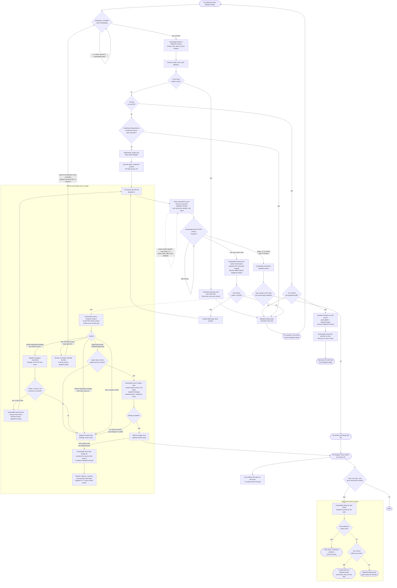
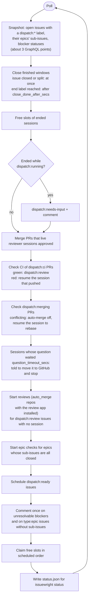
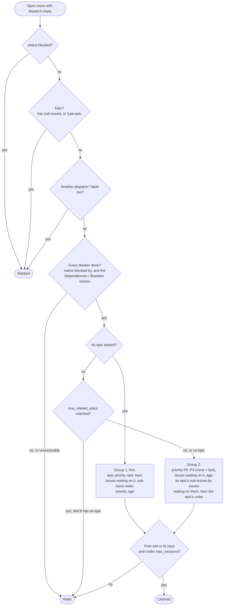

# How issuewright works

Three views of the same process: the life of one issue, what one poll does, and how the scheduler picks the next issue. The [README](../README.md) has the details behind each step.

## The life of an issue

Rounded boxes are steps, diamonds are decisions, and the label after each step is what the issue carries next. Dashed boxes are optional: the fallback auto-close (`close_done_after_secs`) and review and merge (`auto_merge`).

## One poll

At start, issuewright warns about each `auto_merge` repository without the review app, with "Allow auto-merge" off, or without a rule requiring checks or reviews. Then, every `poll_interval_secs`, in this order. CI fixes and reviews claim slots before new issues: finishing work beats starting it.

## Scheduling

Which `dispatch:ready` issue gets the next free slot.

A blocker is done when it is closed as completed or, with `blocker_done = "merged_or_closed"`, when a PR that closes it has merged into its default branch.
